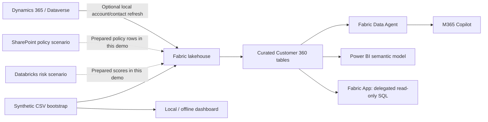

# Get Your Data Ready for Agents with Fabric

## Dynamics 365, SharePoint & Databricks

Turn disconnected customer, service, policy and risk signals into a Customer 360 foundation for analytics and conversational investigation.

**A reusable proof of concept, not a production reference implementation or an autonomous agent.**

### The business question

> How much pipeline is at risk, and are SLA breaches involved?

A sales-only view misses service escalations. A support-only view misses renewal exposure. Policy information adds the boundaries for a response, while prepared churn scores add another signal to investigate.

This project brings those domains into a consistent Fabric-oriented data contract, a read-only Customer 360 application, a semantic-model definition and a Fabric Data Agent setup guide.

## What is included

| Component | Included here | Boundary |
|---|---|---|
| Customer 360 app | Local dashboard, filters, customer briefings, export and offline HTML builder | No AI calls, CRM writes or approvals |
| Fabric Apps / Rayfin | Protected hosting configuration, Fabric sign-in and delegated read-only SQL connector | Deploy in your own supported Fabric environment; preview suitability needs review |
| Synthetic data | Six generated CSV tables and a deterministic generator | Not an export from Dynamics 365, SharePoint or Databricks |
| Fabric ingestion | Demo-table bootstrap notebook and an optional existing-account Dataverse refresh worker | The worker runs on your computer; not a managed ingestion service |
| Power BI | Six-table TMDL semantic-model definition | Rebind to your own endpoint; no report layout, RLS or OLS definitions are included |
| Fabric Data Agent | Instructions, example questions and SQL examples | Create, configure, publish and test your own agent |
| M365 Copilot | Demo prompts and integration guidance | Requires appropriate licensing, tenant settings and user/source permissions |
| Shortcuts, mirroring and Fabric IQ | Architecture and integration guidance | No automatic creation of connections, mirrors, ontologies or external services |

## Architecture



Solid arrows describe implementation paths; dotted arrows identify scenarios represented by prepared data rather than live upstream integrations. The app does not call the Data Agent. The agent guide uses lakehouse tables, not the Power BI model.

## Run locally

Use Node.js 22 or 24, npm and PowerShell. No cloud account is needed for snapshot mode.

```powershell
git clone https://github.com/masinav-msft/get-your-data-ready-for-agents-with-fabric.git
Set-Location get-your-data-ready-for-agents-with-fabric\customer-insights
Copy-Item fabric-config.example.json fabric-config.json
npm ci
npm test
npm start
```

Open **http://127.0.0.1:4173/**. The server binds to loopback by default; this is not a publicly shared site.

Optional:

```powershell
npm run build:html
```

The generated standalone HTML embeds the complete synthetic snapshot. It has no sign-in or row-security boundary; do not generate or distribute one containing restricted data.

## Expected synthetic-demo results

| Metric | Value |
|---|---:|
| Accounts | 12 |
| Annual customer revenue | $31,090,000 |
| Open opportunity pipeline | $5,530,000 |
| Opportunity pipeline at risk | $2,365,000 |
| Pipeline for accounts with churn score >= 65 | $2,090,000 |
| Active SLA breaches | 4 |

The two risk totals intentionally use different definitions. At-risk opportunities have a `Medium Risk`, `High Risk` or `Critical Risk` label. Active SLA breaches are flagged cases not marked `Resolved`.

All shipped records are synthetic. Woodgrove Bank, Contoso Healthcare and Fabrikam Manufacturing are illustrative scenario names; contacts use generic labels and reserved `.invalid` email addresses. Scores, policy ceilings and recommendations are prepared demonstration inputs, not model predictions, approved credits or customer instructions.

## Documentation

- [Setup and Fabric deployment](docs/SETUP.md)
- [Demo flow and executive talk track](docs/DEMO.md)
- [Security, scope and production gates](docs/SECURITY_AND_LIMITATIONS.md)
- [Data Agent instructions](agent/instructions.md) and [SQL examples](agent/examples.sql)
- [Attendee FAQs](docs/ATTENDEE_FAQ.md)
- [Synthetic data generator](scripts/create-demo-data.mjs)
- [Lakehouse bootstrap](notebooks/01_load_synthetic_demo.py)
- [Power BI semantic-model definition](semantic_model/definition.pbism)

## Why this is agent-ready

The useful foundation is connected data, stable customer keys, defined metrics and an explicit query interface. A configured Fabric Data Agent can answer questions using selected tables, and M365 Copilot can provide a conversational entry point.

That is **read-and-investigate readiness**, not autonomous execution. A future action-taking workflow needs scoped action tools, orchestration, human approval where appropriate, audit, evaluation, monitoring and recovery.

## Safe sharing

This repository deliberately excludes the original deployment registry, endpoint addresses, tenant/workspace/item identifiers, raw Dataverse exports, local state, credentials, downloaded dependencies, compiled bundles and original event-branded documents.

Replace example configuration locally. Never commit tokens, customer records or private connection details. Sharing the repository does not grant access to any Fabric workspace, app, semantic model or agent.

No live Fabric resources are provisioned by cloning this repository or running the local tests. See [production gates](docs/SECURITY_AND_LIMITATIONS.md) before connecting real data or sharing with customers.
